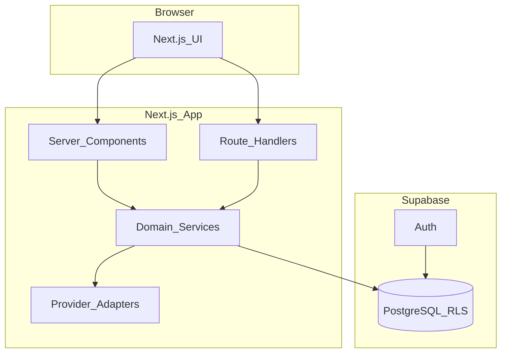

# Architecture

## High-level

## Layers [Confirmed]

| Layer | Location | Responsibility |
|-------|----------|----------------|
| UI | `src/app`, `src/components` | Presentation, a11y, client validation |
| API | `src/app/api` | Authn/z, parse input, HTTP codes |
| Domain | `src/server/domain` | Risk scoring, order rules, usage |
| Data | `src/server/db` | Supabase clients, queries |
| Integrations | `src/server/integrations` | Webhooks, WhatsApp, OpenAI |

## Tenancy [Confirmed]

- Active `business_id` from membership join; never from client body alone.
- User JWT via Supabase Auth; RLS uses `auth.uid()` + membership functions.

## Secrets [Confirmed]

- Service role key server-only for webhooks/admin jobs.
- Anon key in browser for Auth only.
