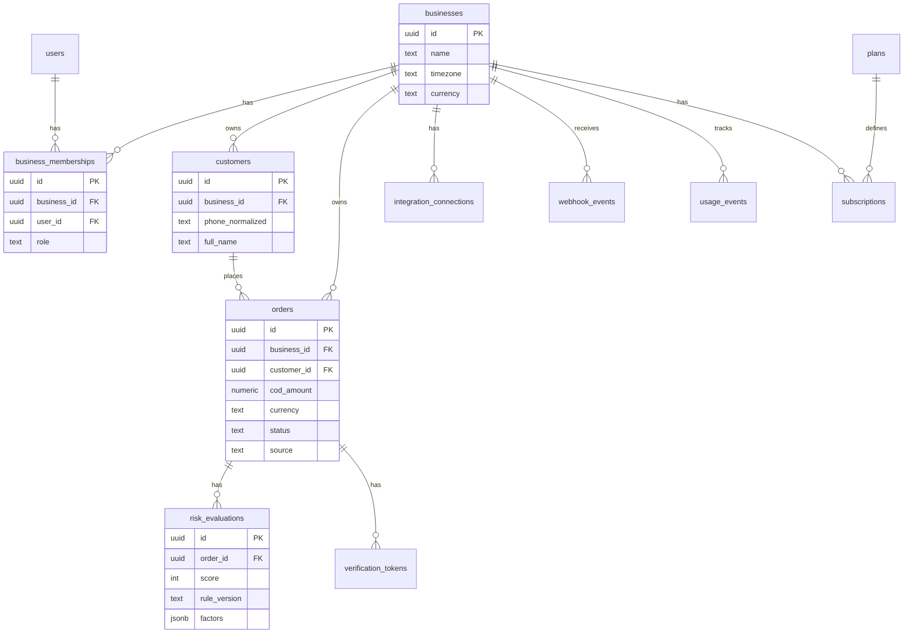

# Database

## ER diagram

## Conventions [Confirmed]

- Timestamps: `timestamptz` UTC.
- Money: `numeric(14,2)` + `currency` column (default `PKR`).
- Migrations: `supabase/migrations/*.sql`.

## RLS [Confirmed]

All tenant tables include `business_id`. Policies:

- **SELECT/INSERT/UPDATE/DELETE:** caller is member of row's `business_id` via `business_memberships`.
- **Super admin:** separate role check via `app_metadata.is_super_admin` + audited service path only.

Helper SQL: `public.is_business_member(business_id uuid)`.

## Indexes [Confirmed]

- `orders (business_id, created_at desc)`
- `orders (business_id, status)`
- `customers (business_id, phone_normalized)`
- `webhook_events (business_id, provider, external_id)` unique for idempotency
